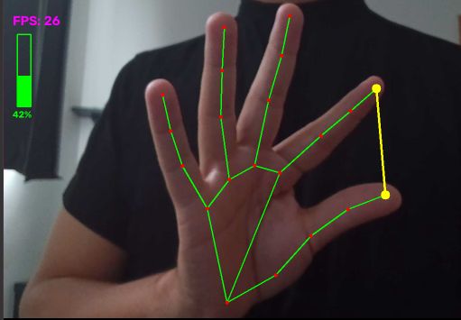

# 🚀 VolumeVision — Real-Time Hand Gesture Recognition with Computer Vision and Machine Learning

VolumeVision is a real-time computer vision system that recognizes a pinch gesture from a camera stream and maps it to a continuous control signal.

It uses Google MediaPipe, a pretrained neural network pipeline for hand landmark detection, together with OpenCV, NumPy and Docker, and runs on CPU with any camera source (USB webcam, IP camera, video file).

Author: Kevin Mota da Costa

Portfolio: [https://costakevinn.github.io](https://costakevinn.github.io)

LinkedIn: [https://linkedin.com/in/costakevinnn](https://linkedin.com/in/costakevinnn)

---



---

## 🎯 Project Purpose

VolumeVision was built to explore machine learning inference in real-time computer vision applications, from camera input to a measurable output.

The distance between the thumb tip and the index tip, estimated by a hand landmark model, is converted into a volume level (0–100) that controls a test tone. The audio is only a simple actuator used to validate the gesture; the focus of the project is the vision pipeline.

---

## 💡 What This Project Demonstrates

* **Computer vision:** frame acquisition, resizing, mirroring, pixel-space geometry and overlay rendering with OpenCV
* **Machine learning inference:** a pretrained neural network (MediaPipe HandLandmarker) running in a real-time loop on CPU
* **Gesture recognition:** landmark-based feature extraction and mapping to a control signal
* **Real-time systems:** per-frame processing, video-mode tracking, callback-based audio, live MJPEG streaming
* **Software engineering:** modular Python packages, YAML configuration, pinned dependencies, Git version control
* **Reproducibility and MLOps basics:** Docker and Docker Compose, hardware profiles, read-only source mount

---

## 🧠 How It Works

Camera frame
→ Resize and horizontal mirror
→ MediaPipe HandLandmarker (palm detection + 21 landmarks)
→ Thumb tip and index tip in pixel coordinates
→ Euclidean distance
→ Clamped linear map to volume (0–100)
→ Tone gain, overlay and live view

---

## 🖐 Hand Landmarks with MediaPipe

The HandLandmarker (Tasks API, `hand_landmarker.task`, float16) is a two-stage pipeline:

* **Palm detector:** a single-shot detector that finds the hand in the full frame
* **Landmark regressor:** predicts 21 3D keypoints inside the detected hand region

In video mode the detector runs only when tracking is lost, which reduces latency. Each landmark has normalized `x`, `y` (relative to image width and height) and a relative depth `z`.

| Index | Landmark   | Use in this project        |
| ----- | ---------- | -------------------------- |
| 4     | Thumb tip  | Pinch point                |
| 8     | Index tip  | Pinch point                |
| 0–20  | All points | Drawn in the live overlay  |

Normalized coordinates are converted to pixels on a fixed frame width (`W = 520`), so the thresholds do not depend on the camera resolution.

---

## 📐 Gesture-to-Volume Mapping

```
d = || p4 - p8 ||₂                                  (pixels)
v = round( 100 · clip( (d - d_min) / (d_max - d_min), 0, 1 ) )
```

with `d_min = 20` and `d_max = 200` (set in `config.yaml`). If no hand is detected, `v = 0`.

The tone gain is interpolated linearly inside each audio block, so volume changes are smooth and free of clicks.

---

## 🏗 Architecture

```
VolumeVision/
├── hardware/     # Camera and audio devices (cam.py, audio.py)
├── vision/       # Hand detection and gesture feature (detector.py, gesture.py)
├── display/      # Live view and overlay (window.py, overlay.py)
├── profiles/     # Hardware profiles (Docker Compose overrides)
├── docs/         # Technical documentation and demo image
├── config.yaml   # Behavior: thresholds, frame width, tone, window
├── main.py       # Real-time loop
├── Dockerfile
└── docker-compose.yml
```

Behavior lives in `config.yaml`. Hardware lives in profiles. The Python code contains no hardware-specific value, so the same code runs with a USB webcam, an IP camera or a video file.

---

## 📚 Engineering Decisions

* Separation of hardware, vision and display layers
* Hardware as configuration (Docker Compose profiles), not code
* Camera source accepts a device index, an HTTP stream URL or a video file
* Live view served as MJPEG over HTTP, so no X11 forwarding is needed
* Click-free audio with a per-block gain ramp
* Pinned dependencies and a containerized environment for reproducible execution
* Container runs as the host user, with the source mounted read-only

Known limitations: the distance is measured in image pixels, so it depends on the hand-to-camera distance; one hand is tracked.

---

## 🛠 Tech Stack

Python

Computer Vision

Machine Learning Inference

MediaPipe (HandLandmarker)

OpenCV

NumPy

Docker / Docker Compose

YAML

Git / GitHub

Linux / WSL

---

## ▶ Usage

Create a hardware profile from an example and set your camera source:

```bash
cp profiles/wsl-ipcam.yml.example profiles/local.yml
```

Build and run (the model is downloaded on first run):

```bash
./build_run.sh
```

Next runs:

```bash
./run.sh
```

Open `http://localhost:8000` to see the live view.

---

## 📄 Documentation

Technical documentation (model interface, coordinates, gesture feature, real-time architecture): [`docs/VolumeVision_documentation.pdf`](docs/VolumeVision_documentation.pdf)

---

## 🌐 Portfolio

This project is part of my Machine Learning portfolio:
👉 [https://costakevinn.github.io](https://costakevinn.github.io)

---

## License

MIT License — see `LICENSE` for details.